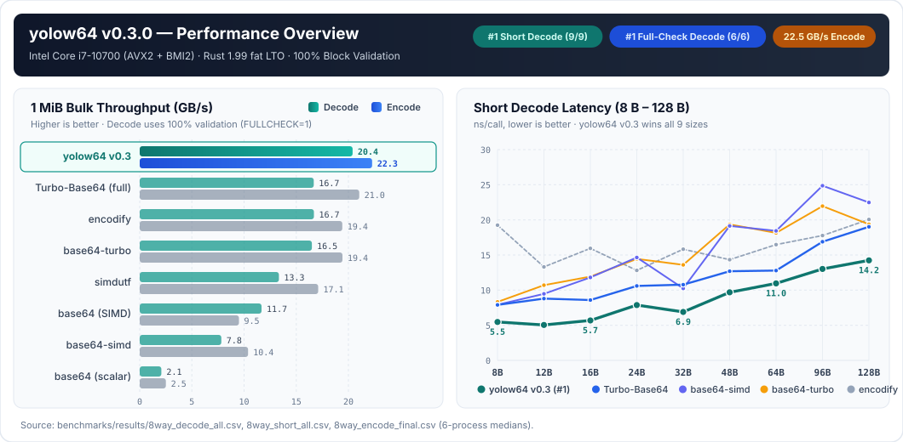
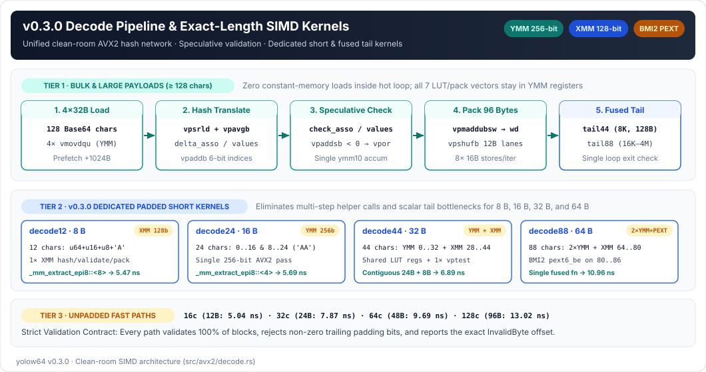
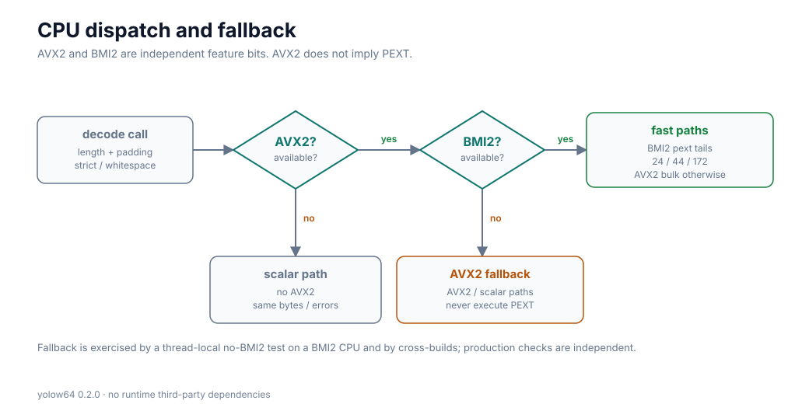
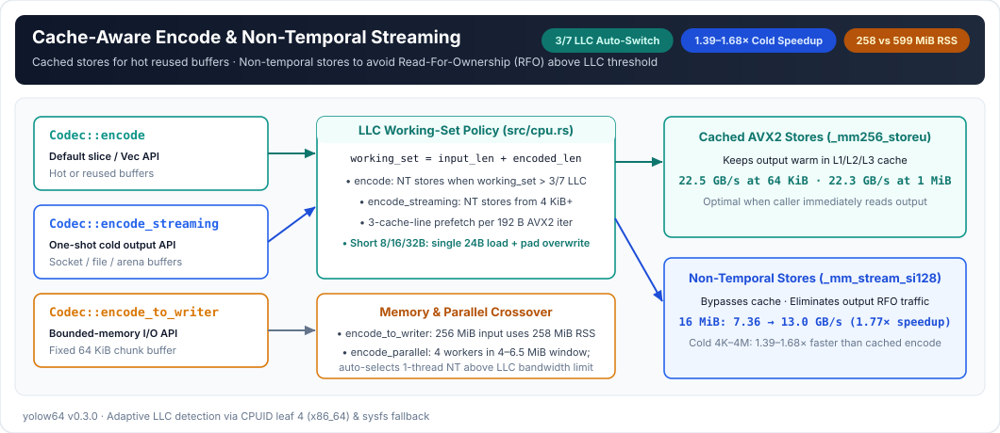
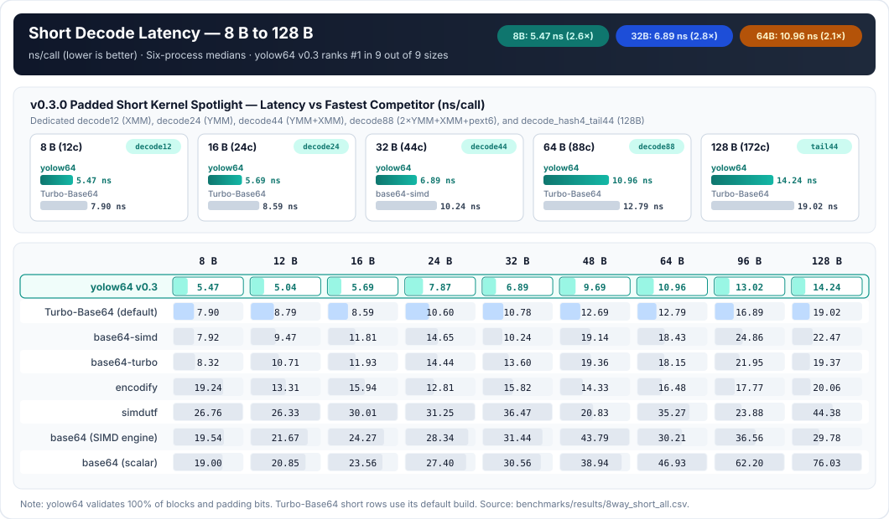
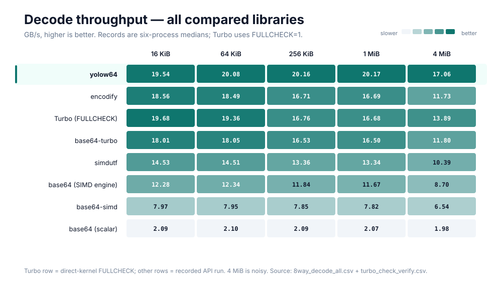
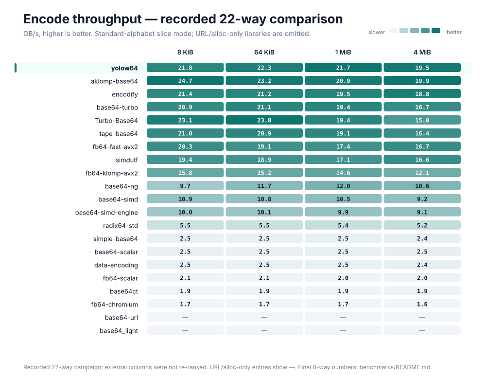

<div align="center">

# yolow64

**High-throughput, full-validation Base64 codec for Rust — zero runtime dependencies.**

[](https://crates.io/crates/yolow64)
[](https://docs.rs/yolow64)
[](https://www.rust-lang.org)
[](LICENSE)

[**English**](README.md) · [**简体中文**](docs/README.zh-CN.md) · [**Benchmarks**](benchmarks/README.md) · [**R&D Notes**](research/README.md) · [**Changelog**](CHANGELOG.md)

</div>



---

## Highlights

- **#1 Short Decode Latency (9 / 9 sizes, 8 B – 128 B)**: Dedicated SIMD short kernels (`decode12` on XMM, `decode24` on YMM, fused `decode44` on YMM+XMM, fused `decode88` on 2×YMM+XMM+BMI2 `pext`) and exact-length unpadded dispatch (`16 / 32 / 64 / 128` chars) lead every single short payload size in the 8-library benchmark.
- **#1 Full-Validation Bulk Decode (8 KiB – 4 MiB)**: Clean-room 4-block AVX2 assembly hash loop (`decode_hash4`) with register-resident LUTs, speculative `vpaddsb` OR-accumulation, and fused tail kernels (`decode_hash4_tail44` and `decode_hash4_tail88`) sustains **20.0–20.4 GB/s** across 8 KiB–1 MiB while validating **100% of blocks and trailing padding bits**.
- **22.5 GB/s Peak Encode + Cache-Aware Non-Temporal Streaming**: Adaptive non-temporal stores above `3/7` of the detected Last-Level Cache (LLC) lift 16 MiB encode from 7.36 to **13.0 GB/s (1.77×)**; `encode_streaming` accelerates one-shot cold buffers by **1.39–1.68×**, and `encode_to_writer` bounds peak RSS via a 64 KiB chunk buffer.
- **Independent Hardware Dispatch & Zero Runtime Dependencies**: Uses only the Rust standard library (`std`) at runtime. `AVX2` and `BMI2` are detected independently via `OnceLock`; `AArch64 NEON` and portable scalar fallbacks share identical validation semantics and error offsets.

---

## Installation

```toml
[dependencies]
yolow64 = "0.3"
```

To enable cache-aware multi-threaded encoding and decoding:

```toml
[dependencies]
yolow64 = { version = "0.3", features = ["parallel"] }
```

---

## Quick Start

```rust
use yolow64::{Alphabet, Codec, Decoder, STANDARD};

fn main() -> Result<(), yolow64::Error> {
    // 1. Standard padded encode & decode
    let encoded = STANDARD.encode_to_string(b"hello")?;
    assert_eq!(encoded, "aGVsbG8=");
    assert_eq!(STANDARD.decode_to_vec(encoded.as_bytes())?, b"hello");

    // 2. URL-safe unpadded configuration
    let url = Codec {
        alphabet: Alphabet::UrlSafe,
        padding: false,
        ignore_whitespace: false,
    };
    assert_eq!(url.encode_to_string(&[0xfb, 0xff])?, "-_8");

    // 3. Chunked streaming decode
    let mut decoder = Decoder::new(STANDARD);
    let mut output = Vec::new();
    decoder.feed(b"aGV", &mut output)?;
    decoder.feed(b"sbG8=", &mut output)?;
    decoder.finish(&mut output)?;
    assert_eq!(output, b"hello");
    Ok(())
}
```

### API Overview

| Category | Methods | Description |
|---|---|---|
| **Zero-Allocation Slice** | `Codec::encode`, `Codec::decode`, `Codec::encoded_len`, `Codec::max_decoded_len` | Writes directly into caller-provided `&mut [u8]` buffers and returns bytes written. |
| **Owned & Append** | `encode_to_string`, `append_encode`, `decode_to_vec`, `append_decode`, `encode_data_url` | Writes directly into spare `Vec` capacity without pre-zeroing. |
| **Streaming & I/O** | `Codec::encode_streaming`, `Codec::encode_to_writer`, `Decoder::new / feed / finish` | One-shot non-temporal cold encode (`≥ 4 KiB`), bounded-RSS `Write` sink (`64 KiB` chunk buffer), and stateful chunked decoder. |
| **Validation** | `Codec::validate` | Verifies alphabet, padding, and trailing bits in place, returning the exact decoded byte length. |
| **Parallel** *(optional)* | `encode_parallel`, `decode_parallel`, `*_with_threads` | Cache-aware worker selection based on input size and detected CPU LLC. |

> **Validation & Error Contract**: `STANDARD` requires canonical `=` padding and rejects whitespace. Setting `ignore_whitespace: true` skips **only** ASCII space (`' '`), tab (`'\t'`), CR (`'\r'`), and LF (`'\n'`). Setting `padding: false` forbids `=`. Every mode rejects non-zero trailing padding bits and reports the exact original byte and offset on `Error::InvalidByte { offset, byte }`. Caller-provided buffers and streaming `Decoder` outputs may contain partial bytes on error and should be discarded when whole-message validity is required.

---

## Architecture







---

## Performance (v0.3.0)

All 8-library comparisons were measured on the same machine, inputs, and 64-byte aligned preallocated buffers (`Intel Core i7-10700` Comet Lake, AVX2 + BMI2, no AVX-512, Linux x86-64, Rust 1.99.0, `lto = "fat"`, `codegen-units = 1`, pinned via `taskset -c 4`). Full reproduction commands, raw per-round CSVs, and hardware counter analyses are in [`benchmarks/README.md`](benchmarks/README.md) and [`research/`](research/README.md).

### 1. Short Input Latency (8 B – 128 B, ns/call, lower is better)

| Input | Encoded | `yolow64` enc | Fastest enc | `yolow64` dec | Fastest dec | Runner-up dec |
|---:|---:|---:|---|---:|---|---|
| **8 B** | 12 chars | **6.02** | **6.02 (`yolow64`)** | **5.47** | **5.47 (`yolow64`)** | 7.90 (`Turbo-Base64`) |
| **12 B** | 16 chars | **7.35** | **7.35 (`yolow64`)** | **5.04** | **5.04 (`yolow64`)** | 8.78 (`Turbo-Base64`) |
| **16 B** | 24 chars | **6.20** | **6.20 (`yolow64`)** | **5.69** | **5.69 (`yolow64`)** | 8.58 (`Turbo-Base64`) |
| **24 B** | 32 chars | **9.01** | **9.01 (`yolow64`)** | **7.87** | **7.87 (`yolow64`)** | 10.62 (`Turbo-Base64`) |
| **32 B** | 44 chars | **7.29** | **7.29 (`yolow64`)** | **6.89** | **6.89 (`yolow64`)** | 10.24 (`base64-simd`) |
| **48 B** | 64 chars | **9.95** | **9.95 (`yolow64`)** | **9.69** | **9.69 (`yolow64`)** | 13.06 (`Turbo-Base64`) |
| **64 B** | 88 chars | 13.41 | 12.11 (`Turbo-Base64`) | **10.96** | **10.96 (`yolow64`)** | 12.79 (`Turbo-Base64`) |
| **96 B** | 128 chars | **11.43** | **11.43 (`yolow64`)** | **13.02** | **13.02 (`yolow64`)** | 16.81 (`Turbo-Base64`) |
| **128 B** | 172 chars | 17.40 | 13.74 (`Turbo-Base64`) | **14.24** | **14.24 (`yolow64`)** | 18.79 (`base64-turbo`) |



In v0.3.0, `yolow64` is **#1 across 9 out of 9 short decode sizes** (even against `Turbo-Base64`'s default partial-check build) and **#1 across 7 out of 9 short encode sizes** in the 8-library harness.

---

### 2. Bulk Decode Throughput (8 KiB – 4 MiB, GB/s, higher is better)

Under equal 100% block validation (`FULLCHECK=1` for `Turbo-Base64`; see [`research/turbo-check.md`](research/turbo-check.md) for disassembly verification of its default 25%-check mode), `yolow64` v0.3.0 leads **every size from 8 KiB through 4 MiB**:

| Input | `yolow64` v0.3 | `Turbo (FULLCHECK)` | `encodify` | `base64-turbo` | `simdutf` | `base64 (SIMD)` | `base64-simd` | `base64 (scalar)` |
|---:|---:|---:|---:|---:|---:|---:|---:|---:|
| **8 KiB** | **20.41** | 20.06 | 19.72 | 18.96 | 16.00 | 12.37 | 8.07 | 2.09 |
| **16 KiB** | **19.95** | 19.68 | 18.56 | 18.01 | 14.53 | 12.28 | 7.97 | 2.09 |
| **64 KiB** | **20.36** | 19.36 | 18.49 | 18.05 | 14.51 | 12.34 | 7.95 | 2.10 |
| **256 KiB** | **20.33** | 16.76 | 16.71 | 16.53 | 13.36 | 11.84 | 7.85 | 2.09 |
| **1 MiB** | **20.40** | 16.68 | 16.69 | 16.50 | 13.34 | 11.67 | 7.82 | 2.07 |
| **4 MiB** | **17.11** | 13.89 | 11.73 | 11.80 | 10.39 | 8.70 | 6.54 | 1.98 |



---

### 3. Bulk Encode Throughput & 22-Library Leaderboard (GB/s, higher is better)

| Input | `yolow64` | `Turbo-Base64` | `encodify` | `base64-turbo` | `simdutf` | `base64-simd` | `base64 (SIMD)` | `base64 (scalar)` |
|---:|---:|---:|---:|---:|---:|---:|---:|---:|
| **8 KiB** | 21.9 | **23.7** | 21.5 | 21.0 | 19.4 | 10.8 | 10.0 | 2.5 |
| **64 KiB** | 22.5 | **23.7** | 21.4 | 20.9 | 18.7 | 10.7 | 10.0 | 2.5 |
| **1 MiB** | **22.3** | 21.0 | 19.4 | 19.4 | 17.1 | 10.4 | 9.5 | 2.5 |
| **4 MiB** | **17.7** *(21.7 NT)* | 16.8 | 15.8 | 15.7 | 14.2 | 9.5 | 8.9 | 2.4 |



### 4. CRLF-Tolerant Decode (GB/s, higher is better)

| Input | `yolow64` (native) | `encodify` (native) | `simdutf` (native) | `Turbo-Base64` (filter+strict) |
|---:|---:|---:|---:|---:|
| **4 KiB** | 7.3 | **9.9** | 7.9 | 1.2 |
| **64 KiB** | 9.4 | **10.4** | 8.1 | 1.2 |
| **1 MiB** | 8.6 | **10.1** | 7.9 | 1.2 |
| **4 MiB** | 6.4 | **7.6** | 7.1 | 1.1 |

---

## Story & License

While building [PageSift](https://github.com/YOLOW92/pagesift), we needed Base64 for browser screenshots, MCP resources, and proxy authentication—workloads where strict RFC validation, allocation control, and real-world throughput are equally critical. `yolow64` extracts that codec into an independent library.

Licensed under [MIT](LICENSE). Third-party benchmark attribution and notices: [THIRD-PARTY.md](THIRD-PARTY.md).
