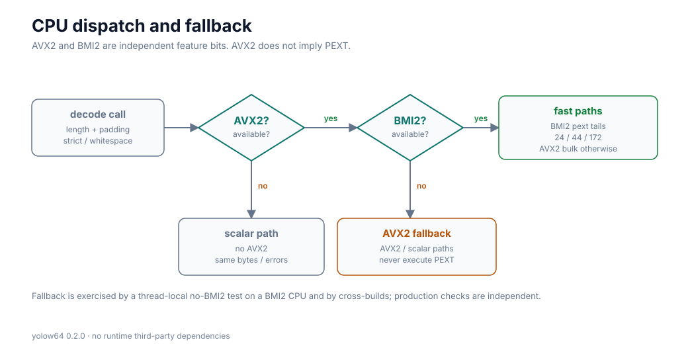
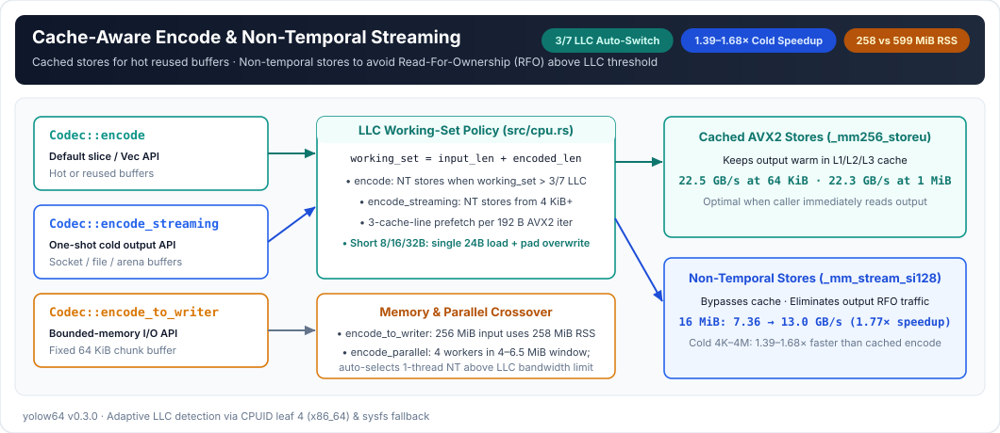

# API reference

The generated Rust documentation (`cargo doc --no-deps --open`) is the authoritative API reference. This page summarizes the entry points.

## Configuration

`Codec { alphabet, padding, ignore_whitespace }` selects `Alphabet::Standard` or `Alphabet::UrlSafe`. When `padding` is true, padding is required where needed; when false, `=` is forbidden. Unused bits in the last symbol must be zero.

`STANDARD` selects the standard alphabet, padded form and strict whitespace. `ignore_whitespace` permits exactly ASCII space, tab, CR and LF; all other invalid bytes remain errors.

## CPU features and fallback

AVX2 and BMI2 are independent CPU features and are detected separately at
runtime. The BMI2 `pext` tails used by some short decode lengths run only when
**both** AVX2 and BMI2 are present. A CPU with AVX2 but without BMI2 takes the
AVX2/scalar fallback and never executes `pext`; a CPU without AVX2 takes the
scalar path. The same decoded bytes and the same validation rules are used on
every path.

## Buffers and owned values

| API | Result |
|---|---|
| `Codec::encoded_len(input_len)` | Exact encoded capacity, or `None` on overflow |
| `Codec::encode(input, output)` | Encoded bytes written, or an error; cache-friendly default |
| `Codec::encode_streaming(input, output)` | One-shot encode with non-temporal stores from 4 KiB when the output is 16-byte aligned |
| `Codec::decode(input, output)` | Decoded bytes written, or an error; exact-length short paths are selected automatically |
| `Codec::validate(input)` | Exact decoded length, or an error |
| `Codec::encode_to_string(input)` | New encoded `String` |
| `Codec::encode_to_writer(input, writer)` | Encode through a fixed 64 KiB output buffer to any `std::io::Write` |
| `Codec::decode_to_vec(input)` | New decoded `Vec<u8>` |
| `Codec::append_encode(input, output)` | Append encoded bytes to a `Vec<u8>` |
| `Codec::append_decode(input, output)` | Append decoded bytes to a `Vec<u8>`; on error its original length is restored |
| `encode_data_url(mime, input)` | Standard padded data URL; MIME is not validated |
| `decode_standard_compat(input)` | Standard decode with `base64` 0.23-compatible error text (`Result<Vec<u8>, String>`) |

Owned and append APIs write into `Vec` spare capacity; they do not zero-fill the destination first.

Input and output slices must be separate. On error, a caller-provided decode output can contain partial bytes and should be discarded. Errors are `InvalidByte { byte, offset }`, `InvalidLength`, `InvalidPadding`, or `OutputTooSmall`. An invalid-byte offset refers to the original input, including whitespace.

## Streaming

`Codec::encode_streaming` is the one-shot slice encode entry point. It writes the output with non-temporal stores from 4 KiB upward when the output pointer is 16-byte aligned, avoiding the read-for-ownership that `Codec::encode` pays when the output is not reused. Use `encode_streaming` for sockets, files and compressors; use `encode` when the same output buffer is reused or immediately reread from cache. At 16 MiB both paths already use streaming stores.

`Codec::encode_to_writer` is the memory-bounded entry point. It processes 48 KiB multiples of three through a fixed 64 KiB output buffer, so peak library memory does not grow with the encoded output. For a 256 MiB input, measured peak RSS is about 258 MiB versus 599 MiB for `encode_to_string`. The writer path adds one copy and one `write_all` per 64 KiB; wrap a syscall-heavy writer in `BufWriter`.

`Decoder::new(codec)` creates an incremental decoder. Call `feed(chunk, &mut output)` for each chunk and `finish(&mut output)` to validate the last group. `feed` decodes complete groups in bulk and keeps only the 0–3 byte remainder for the next chunk; padding and whitespace fall back to the byte-wise path. Output appended before an error is not rolled back; discard it when the complete message must be valid. After an error, do not reuse the decoder.

## Parallel

The optional `parallel` feature adds:

- `Codec::encode_parallel(input, output)`
- `Codec::decode_parallel(input, output)`
- `Codec::encode_parallel_with_threads(input, output, threads)`
- `Codec::decode_parallel_with_threads(input, output, threads)`

The automatic methods keep short inputs on the single-threaded path. Encode estimates the input+output working set against the detected last-level cache and uses up to four workers while that working set fits; above the cache limit the single-thread streaming-store path is faster, so encode remains single-threaded there. Decode still uses a conservative two-worker cap and a 7/8-cache margin until its own crossover round. Decode with `ignore_whitespace` currently falls back to the single-threaded path because whitespace changes the character grid. The `_with_threads` variants force a worker cap for experiments (the value is clamped to available CPUs). The default APIs never spawn threads.

Run `cargo run --example basic` for a compilable example.
