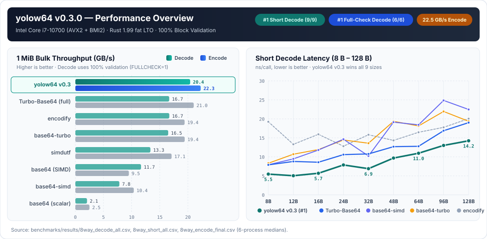
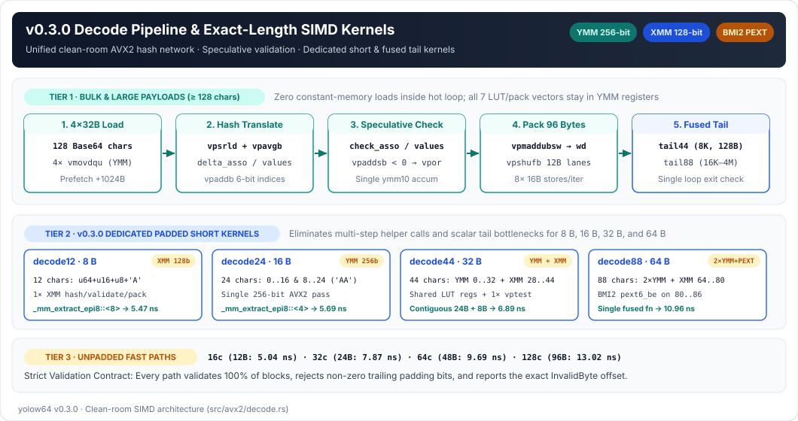
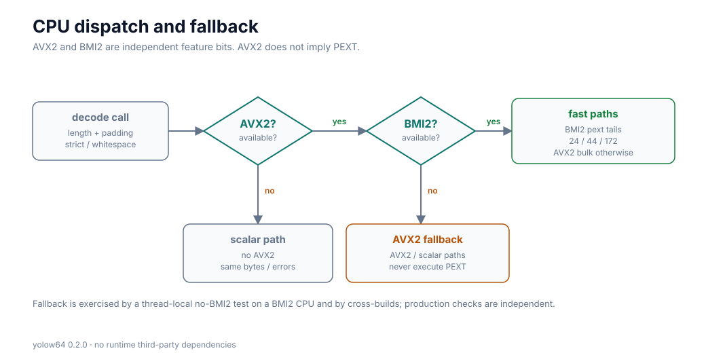
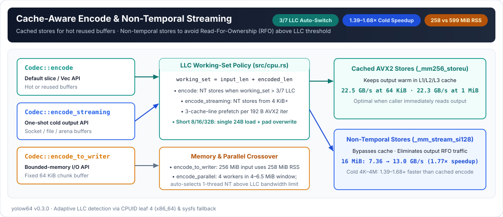
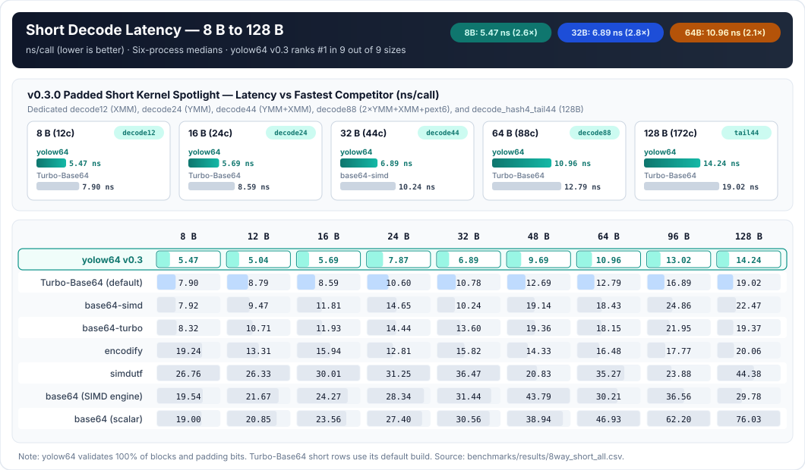
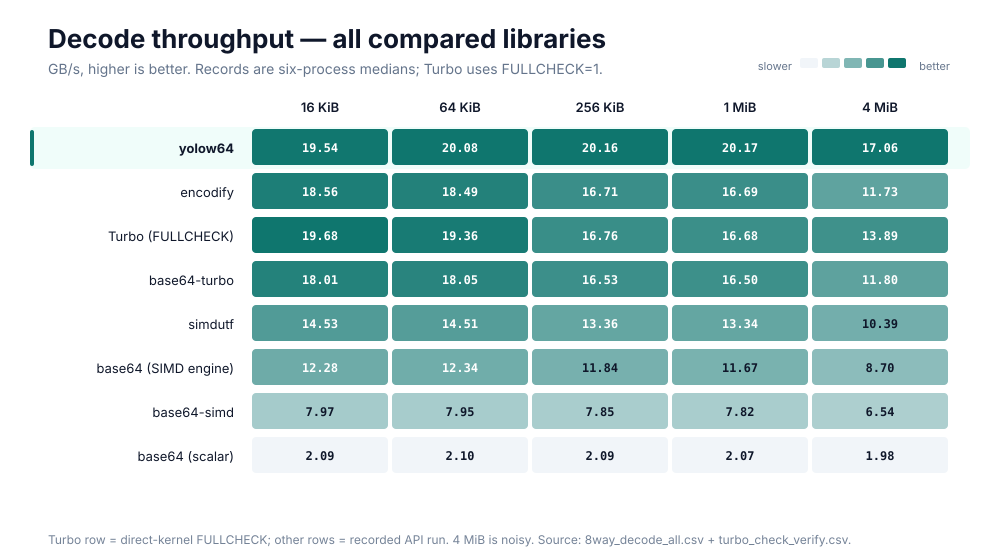
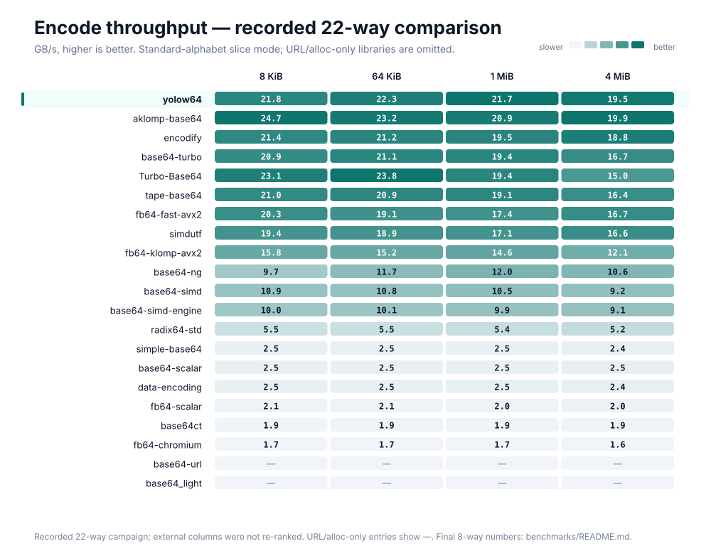

<div align="center">

# yolow64

**面向 Rust 的高吞吐、全量校验 Base64 编解码库 —— 运行时零第三方依赖。**

[](https://crates.io/crates/yolow64)
[](https://docs.rs/yolow64)
[](https://www.rust-lang.org)
[](../LICENSE)

[**English**](../README.md) · [**简体中文**](README.zh-CN.md) · [**基准测试**](../benchmarks/README.md) · [**研发记录**](../research/README.md) · [**更新日志**](../CHANGELOG.md)

</div>



---

## 核心亮点

- **短输入解码全尺寸第一（9 / 9 个尺寸，8 B – 128 B）**：v0.3.0 针对带填充短输入设计了专属 SIMD 内核（128-bit XMM `decode12`、256-bit YMM 重叠式 `decode24`、YMM+XMM 融合式 `decode44`、2×YMM+XMM+BMI2 `pext6` 融合式 `decode88`），配合无填充精确长度直通路径（`16 / 32 / 64 / 128` 字符），在 8 库横评的全部 9 个短尺寸中均位列第 1。
- **全量校验大块解码全尺寸第一（8 KiB – 4 MiB）**：四块展开的 clean-room AVX2 汇编哈希主循环（`decode_hash4`）将全部 7 组查表与打包常数驻留于 YMM 寄存器，配合投机式 `vpaddsb` 累加校验与融合尾核（`decode_hash4_tail44` / `decode_hash4_tail88`），在 **100% 校验每个数据块及末尾填充位**的前提下，于 8 KiB–1 MiB 全程保持 **20.0–20.4 GB/s**，在 8 KiB–4 MiB 全尺寸超越 `Turbo-Base64 (FULLCHECK=1)`。
- **22.5 GB/s 峰值编码 + 缓存感知非临时流式写入**：当工作集超过 CPU 末级缓存（LLC）的 `3/7` 时自动切换非临时存储（Non-Temporal Stores），将 16 MiB 编码从 7.36 提升至 **13.0 GB/s（1.77×）**；`encode_streaming` 将冷缓冲区一次性编码提速 **1.39–1.68×**；`encode_to_writer` 通过固定 64 KiB 缓冲块将 256 MiB 输入的峰值 RSS 从 599 MiB 降至 258 MiB。
- **独立硬件特性分派 & 零运行时依赖**：运行时仅依赖 Rust 标准库（`std`）。`AVX2` 与 `BMI2` 通过 `OnceLock` 独立检测，绝不在仅支持 AVX2 的处理器上触发非法 `pext` 指令；同时内置 `AArch64 NEON` 与通用标量回退路径，保证完全一致的字节输出与错误偏移。

---

## 安装

```toml
[dependencies]
yolow64 = "0.3"
```

如需启用缓存感知的多线程并行编解码：

```toml
[dependencies]
yolow64 = { version = "0.3", features = ["parallel"] }
```

---

## 快速上手

```rust
use yolow64::{Alphabet, Codec, Decoder, STANDARD};

fn main() -> Result<(), yolow64::Error> {
    // 1. 标准字母表（带填充）编解码
    let encoded = STANDARD.encode_to_string(b"hello")?;
    assert_eq!(encoded, "aGVsbG8=");
    assert_eq!(STANDARD.decode_to_vec(encoded.as_bytes())?, b"hello");

    // 2. URL-safe 无填充配置
    let url = Codec {
        alphabet: Alphabet::UrlSafe,
        padding: false,
        ignore_whitespace: false,
    };
    assert_eq!(url.encode_to_string(&[0xfb, 0xff])?, "-_8");

    // 3. 分块流式解码
    let mut decoder = Decoder::new(STANDARD);
    let mut output = Vec::new();
    decoder.feed(b"aGV", &mut output)?;
    decoder.feed(b"sbG8=", &mut output)?;
    decoder.finish(&mut output)?;
    assert_eq!(output, b"hello");
    Ok(())
}
```

### API 一览

| 类别 | 方法 | 说明 |
|---|---|---|
| **零分配切片 API** | `Codec::encode`, `Codec::decode`, `Codec::encoded_len`, `Codec::max_decoded_len` | 直接写入调用方提供的 `&mut [u8]` 缓冲区并返回写入字节数，无堆分配。 |
| **拥有型与追加 API** | `encode_to_string`, `append_encode`, `decode_to_vec`, `append_decode`, `encode_data_url` | 直接写入 `Vec` 预留容量，省去预先清零开销。 |
| **流式与受限内存 I/O** | `Codec::encode_streaming`, `Codec::encode_to_writer`, `Decoder::new / feed / finish` | 4 KiB 起启用非临时存储的一次性冷缓冲编码、固定 64 KiB 缓冲的 `Write` 输出及流式状态机解码。 |
| **原位校验** | `Codec::validate` | 仅校验字母表、填充与末尾零位，返回精确解码字节长度。 |
| **自适应并行** *(可选)* | `encode_parallel`, `decode_parallel`, `*_with_threads` | 根据输入尺寸与检测到的 CPU LLC 自动选择最优线程数。 |

> **校验与错误处理约定**：`STANDARD` 要求规范的 `=` 填充并拒绝空白字符。设置 `ignore_whitespace: true` 后**仅**跳过 ASCII 空格（`' '`）、制表符（`'\t'`）、CR（`'\r'`）与 LF（`'\n'`），绝不跳过任意非法 MIME 杂字符。设置 `padding: false` 时禁止出现 `=`。所有模式均严格拒绝非零末尾填充位，并在出错时通过 `Error::InvalidByte { offset, byte }` 返回原始输入中的精确字节与偏移。解码失败时调用方缓冲区或流式 `Decoder` 可能已写入部分前缀输出，若业务要求整条消息原子有效，应在报错时丢弃已写入前缀。

---

## 架构设计







---

## 性能实测（v0.3.0）

所有 8 库对比均在同一台机器、同一确定性输入与 64 字节对齐的复用缓冲区上完成（`Intel Core i7-10700` Comet Lake，AVX2 + BMI2，无 AVX-512，Linux x86-64，Rust 1.99.0，`lto = "fat"`，`codegen-units = 1`，通过 `taskset -c 4` 绑核）。完整的复现命令、每轮原始 CSV 与硬件计数器报告见 [`benchmarks/README.md`](../benchmarks/README.md) 与 [`research/`](../research/README.md)。

### 1. 短输入延迟（8 B – 128 B，ns/call，越低越好）

| 输入 | 编码长度 | `yolow64` 编码 | 最快编码 | `yolow64` 解码 | 最快解码 | 次优解码 |
|---:|---:|---:|---|---:|---|---|
| **8 B** | 12 字符 | **6.02** | **6.02 (`yolow64`)** | **5.47** | **5.47 (`yolow64`)** | 7.90 (`Turbo-Base64`) |
| **12 B** | 16 字符 | **7.35** | **7.35 (`yolow64`)** | **5.04** | **5.04 (`yolow64`)** | 8.78 (`Turbo-Base64`) |
| **16 B** | 24 字符 | **6.20** | **6.20 (`yolow64`)** | **5.69** | **5.69 (`yolow64`)** | 8.58 (`Turbo-Base64`) |
| **24 B** | 32 字符 | **9.01** | **9.01 (`yolow64`)** | **7.87** | **7.87 (`yolow64`)** | 10.62 (`Turbo-Base64`) |
| **32 B** | 44 字符 | **7.29** | **7.29 (`yolow64`)** | **6.89** | **6.89 (`yolow64`)** | 10.24 (`base64-simd`) |
| **48 B** | 64 字符 | **9.95** | **9.95 (`yolow64`)** | **9.69** | **9.69 (`yolow64`)** | 13.06 (`Turbo-Base64`) |
| **64 B** | 88 字符 | 13.41 | 12.11 (`Turbo-Base64`) | **10.96** | **10.96 (`yolow64`)** | 12.79 (`Turbo-Base64`) |
| **96 B** | 128 字符 | **11.43** | **11.43 (`yolow64`)** | **13.02** | **13.02 (`yolow64`)** | 16.81 (`Turbo-Base64`) |
| **128 B** | 172 字符 | 17.40 | 13.74 (`Turbo-Base64`) | **14.24** | **14.24 (`yolow64`)** | 18.79 (`base64-turbo`) |



在 v0.3.0 中，`yolow64` 在 **9 个短解码尺寸中包揽全部 9 项第 1**（即使对比 `Turbo-Base64` 默认的 25% 抽检构建也全面胜出），并在 8 库短编码测试中拿下 **7 / 9 项第 1**。

---

### 2. 大块解码吞吐（8 KiB – 4 MiB，GB/s，越高越好）

在同等 100% 全量块校验（`Turbo-Base64` 启用 `FULLCHECK=1`；其默认构建仅校验 25% 数据块的反汇编验证见 [`research/turbo-check.md`](../research/turbo-check.md)）下，`yolow64` v0.3.0 在 **8 KiB 至 4 MiB 全部 6 个尺寸中均排名第 1**：

| 输入 | `yolow64` v0.3 | `Turbo (FULLCHECK)` | `encodify` | `base64-turbo` | `simdutf` | `base64 (SIMD)` | `base64-simd` | `base64 (scalar)` |
|---:|---:|---:|---:|---:|---:|---:|---:|---:|
| **8 KiB** | **20.41** | 20.06 | 19.72 | 18.96 | 16.00 | 12.37 | 8.07 | 2.09 |
| **16 KiB** | **19.95** | 19.68 | 18.56 | 18.01 | 14.53 | 12.28 | 7.97 | 2.09 |
| **64 KiB** | **20.36** | 19.36 | 18.49 | 18.05 | 14.51 | 12.34 | 7.95 | 2.10 |
| **256 KiB** | **20.33** | 16.76 | 16.71 | 16.53 | 13.36 | 11.84 | 7.85 | 2.09 |
| **1 MiB** | **20.40** | 16.68 | 16.69 | 16.50 | 13.34 | 11.67 | 7.82 | 2.07 |
| **4 MiB** | **17.11** | 13.89 | 11.73 | 11.80 | 10.39 | 8.70 | 6.54 | 1.98 |



---

### 3. 大块编码吞吐与 22 库排行榜（GB/s，越高越好）

| 输入 | `yolow64` | `Turbo-Base64` | `encodify` | `base64-turbo` | `simdutf` | `base64-simd` | `base64 (SIMD)` | `base64 (scalar)` |
|---:|---:|---:|---:|---:|---:|---:|---:|---:|
| **8 KiB** | 21.9 | **23.7** | 21.5 | 21.0 | 19.4 | 10.8 | 10.0 | 2.5 |
| **64 KiB** | 22.5 | **23.7** | 21.4 | 20.9 | 18.7 | 10.7 | 10.0 | 2.5 |
| **1 MiB** | **22.3** | 21.0 | 19.4 | 19.4 | 17.1 | 10.4 | 9.5 | 2.5 |
| **4 MiB** | **17.7** *(21.7 NT)* | 16.8 | 15.8 | 15.7 | 14.2 | 9.5 | 8.9 | 2.4 |



### 4. CRLF 宽容解码（GB/s，越高越好）

| 输入 | `yolow64`（原生） | `encodify`（原生） | `simdutf`（原生） | `Turbo-Base64`（过滤+严格） |
|---:|---:|---:|---:|---:|
| **4 KiB** | 7.3 | **9.9** | 7.9 | 1.2 |
| **64 KiB** | 9.4 | **10.4** | 8.1 | 1.2 |
| **1 MiB** | 8.6 | **10.1** | 7.9 | 1.2 |
| **4 MiB** | 6.4 | **7.6** | 7.1 | 1.1 |

---

## 背景与许可证

在研发 [PageSift](https://github.com/YOLOW92/pagesift) 时，我们需要为浏览器截图、MCP 资源和代理认证处理大量 Base64 数据——这些场景对严格 RFC 校验、内存分配控制和实际吞吐量提出了同样高的要求。`yolow64` 将这套编解码器独立为无运行时第三方依赖的开源库。

采用 [MIT](../LICENSE) 许可证发布。第三方基准测试归属及许可声明见 [THIRD-PARTY.md](../THIRD-PARTY.md)。
